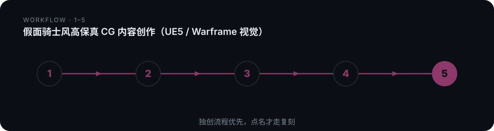

# domn-film-kamen-raider


> 假面骑士风格（UE5/Warframe 高保真 CG）全链路内容创作：生骑士角色设计图、策划变身分镜、生成 30s 危机→变身→战斗成片提示词。

## 真实产出样例

下面是这个技能**实际会产出**的东西（抽自仓库内的 references/ 真实交付样例），不是抽象描述：

```text
画风锁定：UE5 实时渲染，Nanite 超高模，Lumen 全局光照，Warframe 风格生物机械装甲，
          发光能量纹路，能量护目，禁止 anime/cel-shading/rubber suit/low-poly。
四拍结构（所有骑士通用）：
T0 激活  道具发光、手势启动          慢（0.0–0.8s）
T1 包裹  光线沿身体布线/粒子涌动      加速（0.8–2.2s）  ← 骑士型=包裹，本体不消失
T2 拼装  装甲板从四周飞入拼合         高潮（2.2–4.0s）
T3 定格  爆闪+标志性 pose+slow-mo    骤停（4.0–6.5s）
```

## 是什么

假面骑士风格（UE5/Warframe 高保真 CG）全链路内容创作：生骑士角色设计图、策划变身分镜、生成 30s 危机→变身→战斗成片提示词。 本仓库是一个 Agent 技能（SKILL.md 为唯一权威定义），把上面的方法论沉淀为可被对话触发的可执行流程。

## 为什么不同

它是 henshin 通用变身基类在「装甲骑士型」上的特化——锁定 UE5/Warframe 画风、强制双参考图(起态+终态)、走四拍+T0 锚点四连，终结必须由该骑士母题结算而非通用骑士踢。

## 怎么做（工作流）

<p align="center">
  
</p>

> 独创优先；终结由骑士母题结算，非通用骑士踢

1. **解析双图** — 读起态/终态两张参考图，定画风与角色
2. **五段因果链** — 危机→召唤→变身→战斗→收尾 五段各有因果
3. **套四拍+Cam** — T0-T3 四拍 + Cam1-4 机位锚定
4. **动态系统** — 定技能组与母题化终结动作
5. **成片三段** — 危机/变身/战斗 三段提示词编译

## 怎么用

将本仓库放入支持 `SKILL.md` 的 Agent 技能目录：

- **WorkBuddy**：`~/.workbuddy/skills/domn-film-kamen-raider/`
- **Codex / 其他**：对应 skills 目录

然后在对话中触发，例如：

```
用 domn-film-kamen-raider 给我一组 UE5 风格假面骑士变身分镜：腰带插入 → 装甲拼装 → 母题终结。
```

## 依赖

纯提示词方法论 + references/ 弹药库；涉及出图/视频时依赖外部图像生成或文生视频模型。

## 仓库结构

```
domn-film-kamen-raider/
├── SKILL.md                 # 技能定义（唯一权威）
├── assets/                  # 模板 / 占位素材
├── references/              # 方法论弹药库
└── assets/readme/           # 本 README 的视觉资产（hero.webp / workflow.svg）
```

## 许可

本仓库内容以 `SKILL.md` 为唯一权威定义。如附带 `LICENSE` 文件，以其为准。

---

*README 由 `beautify-github-readme` 生成 · 封面图来自作者作品集，强调色由封面采样派生；工作流图为每技能独立 motif。*